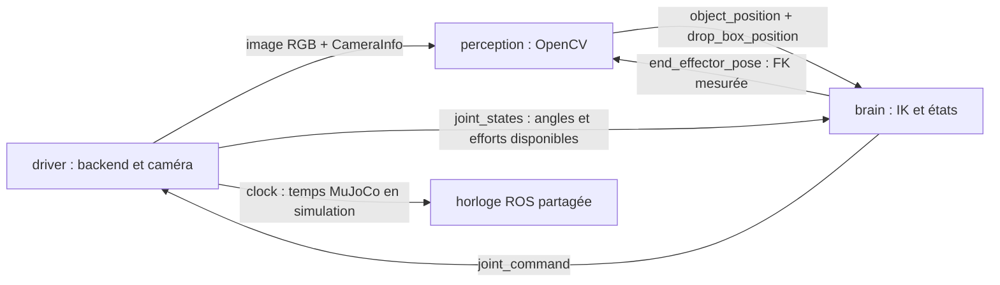

# SO-ARM101 — fonctionnement, corrections et présentation

> Validation finale V6 : **17/20 réussites strictes (85 %)**, objectif de 90 %
> non atteint. **32 tests de régression passent**. Aucun essai sur robot physique.

Ce document décrit la phase 1 du sujet : reconnaître le cube rouge perforé de
50 mm, le saisir avec le SO-ARM101, le transporter et le déposer dans la boîte.
Il décrit le code livré et les limites réellement mesurées. Les essais de cette
intervention concernent exclusivement MuJoCo ; aucun robot physique n'a été connecté.

Le cadre est [docs/SUJET.md](docs/SUJET.md). Le diagnostic détaillé est dans
[docs/GRASP_DIAGNOSIS.md](docs/GRASP_DIAGNOSIS.md) et toutes les commandes de
reproduction sont dans [docs/GRASP_VALIDATION.md](docs/GRASP_VALIDATION.md).

## 1. Architecture et circulation des données



Le pilote est le seul nœud qui accède au backend. Il choisit `SO101Sim` ou
`SO101Follower` avec `use_sim`. Le brain et la perception n'importent pas MuJoCo
et n'accèdent pas à `get_object_position()`. Cette fonction est réservée aux
tests et au diagnostic. La caméra fournit l'observation utilisée pour décider.

Les commandes du brain passent toujours par `/joint_command`, avec un message
`sensor_msgs/JointState`. Les cinq articulations du bras sont commandées en
**radians**. La commande du gripper représente un **pourcentage de 0 à 100** ;
son retour dans `/joint_states` est converti en radians, comme dans l'URDF.

| Échange | Producteur → consommateur | Contenu |
|---|---|---|
| `/external_cam/image_raw` | driver → perception | image RGB, timestamp de capture |
| `/external_cam/camera_info` | driver → perception | matrice intrinsèque K, résolution |
| `/joint_states` | driver → brain et perception | angles réellement atteints, efforts Nm si disponibles |
| `/object_position` | perception → brain | pose estimée du cube dans le repère robot |
| `/drop_box_position` | perception → brain | station de dépôt calibrée, présence vérifiée sur l'image |
| `/end_effector_pose` | brain → perception | pose FK calculée depuis les angles mesurés, pour l'occlusion des doigts |
| `/joint_command` | brain → driver | consignes articulaires, ouverture, effort optionnel du gripper |
| `/clock` | driver → horloges ROS | temps physique simulé, pour les lancements en simulation |

Le driver contrôle à 50 Hz et publie les articulations à 30 Hz. Le brain tourne
à 20 Hz ; la caméra du lancement normal vise 15 Hz. Le banc déterministe utilise
une caméra à 10 Hz et une intégration MuJoCo de 2 ms. La vitesse physique ne
dépend plus du nombre de lectures des capteurs.

L'infrastructure fournit deux images Docker, contrôle et perception. Les essais
physiques reproductibles exécutent les trois nœuds avec de vrais topics ROS dans
un conteneur isolé. L'image de perception séparée a aussi été construite et son
nœud instancié ; cela ne constitue pas un essai complet entre deux conteneurs.

## 2. Comment la perception obtient une pose 3D

La perception filtre le rouge en HSV, puis ajuste la projection de la géométrie
connue du cube à sa silhouette. La taille connue de 50 mm, les paramètres de
caméra et la silhouette donnent une estimation de position et d'orientation.
Ce calcul prend en compte les pixels coupés par le bord de l'image et l'occlusion
par les doigts ou les parois de la boîte.

Au départ, le cube est supposé posé sur la table. Après fermeture, le modèle peut
estimer sa hauteur, son yaw et son inclinaison. Il ne force donc pas un cube
soulevé à rester sur le plan de table. La FK des articulations mesurées sert à
modéliser les doigts visibles et l'enveloppe possible d'un cube tenu ; une
correspondance avec l'image reste obligatoire. Une pose n'est jamais fabriquée
à partir de la FK seule.

Chaque observation conserve le timestamp de l'image source. Une perte de
détection interrompt sa publication ; une ancienne mesure n'est pas republiée
avec une date nouvelle. Le brain rejette les positions périmées, non finies,
dans un mauvais repère, ou reçues dans le désordre.

**Limite de calibration :** la caméra et la position fixe de la boîte sont
calibrées depuis la scène fournie. La présence marron des parois est vérifiée
dans l'image, mais leur position n'est pas librement reconstruite. Déplacer la
caméra ou la boîte exige une nouvelle calibration. La calibration personnelle
demandée en fin de sujet pour le robot réel reste à faire.
Avec `use_sim=false`, le pilote ne produit pas d'images : une acquisition caméra
réelle devra fournir `/external_cam/image_raw` et `CameraInfo` avec sa calibration.

## 3. Du cube observé à un mouvement réalisable

Le TCP est le repère utilisé par la cinématique pour représenter le centre de
prise. Il est placé à 25 mm de la face intérieure du doigt fixe et 8 mm au-dessus
de l'ancien repère de bout de doigt. L'URDF et le site MuJoCo ont la même pose.
Un jeu de 3 mm du côté fixe est appliqué à la cible de prise selon son orientation.

Le cube possède quatre faces équivalentes autour de son axe vertical. Le
planificateur essaie donc le yaw observé, puis ses rotations de 90°, 180° et
270°, pour respecter les limites de `wrist_roll` et la faisabilité du trajet.

La chaîne est construite avec ikpy. La résolution bornée minimise les résidus
de position et d'orientation. Une solution n'est acceptée que si son erreur
cartésienne est au plus de **2 mm** et son erreur d'orientation au plus de
**6° à la prise**, **28° sur les autres points**. Les cinq degrés de liberté ne
permettent pas d'imposer arbitrairement six coordonnées indépendantes : les
contraintes d'orientation doivent rester compatibles avec le bras.

Avant de saisir, le prévol valide tous les points de descente, de levage et de
transport. Les segments sont découpés en pas cartésiens d'au plus 5 mm. Le
transport suit un arc autour de l'épaule pour éviter de traverser une zone
centrale non atteignable. Si le levage vertical est impossible, le prévol peut
prévoir une rétraction vers l'épaule pendant le levage ; la pose initiale du
cube n'est pas déplacée pour faciliter l'essai.

Le prévol utilise un worker et sa propre chaîne. Le brain continue de recevoir
les observations et de commander Home pendant le calcul. Après le calcul, il
revérifie la fraîcheur et la stabilité de la cible. Une solution IK hors
tolérances provoque un refus ou une récupération, sans repli non contraint.

## 4. Machine à états et confirmation physique

| État | Condition et action principales |
|---|---|
| `INIT` | rejoindre Home et attendre le feedback stable |
| `IDLE` | attendre trois observations distinctes et stables du cube, ainsi qu'une boîte visible |
| `PLANNING` | prévalider le trajet complet hors de la boucle de contrôle |
| `APPROACH` | rejoindre la pose au-dessus du cube, puis vérifier que la cible est encore fraîche |
| `LOWER` | descendre sur les points IK validés |
| `GRASP` | fermer progressivement et détecter la charge moteur |
| `LIFT` | lever ; attendre la convergence et une confirmation visuelle de hauteur |
| `TRANSPORT` | suivre l'arc prévalidé, avec confirmation régulière du maintien |
| `PLACE` | descendre au-dessus du fond en tenant compte de l'inclinaison estimée du cube |
| `RELEASE` | ouvrir et attendre l'ouverture réellement atteinte |
| `CLEAR` | dégager verticalement les doigts avant tout retour latéral |
| `RETRACT` | revenir à Home |
| `VERIFY` | exiger quatre observations fraîches montrant le cube entier dans la boîte |
| `FINISHED` | fin du cycle applicatif ; le banc vérifie encore les critères physiques |
| `RECOVER` / `FAILED` | récupération bornée ou arrêt explicite sur défaut |

La convergence demande une erreur articulaire maximale inférieure à 0,015 rad
pendant 0,2 s. Les trajectoires et leurs références ont des vitesses et
accélérations bornées. Les délais maximaux tiennent compte du parcours au lieu
de supposer qu'un nombre fixe de cycles suffit.

La pince approche à 55 % d'ouverture. Pendant la fermeture, le brain reconnaît
une charge de serrage supérieure à 0,4 Nm pendant 0,1 s, puis conserve un effort
de fermeture de 0,5 Nm pendant levage, transport et descente. Cet effort passe
par le champ optionnel `effort` de `/joint_command`. Le backend simulé le traduit
avec les actionneurs, gains et limites de force existants.

Un gripper fermé ne suffit pas à confirmer une prise. Le brain exige une pose
visuelle fraîche du cube, proche de la pince et au moins 5 cm plus haut qu'au
départ. Une perte de cible pendant le transport stoppe la progression, puis
déclenche un échec contrôlé si elle persiste. Le feedback articulaire périmé
entraîne également un arrêt. Deux récupérations au maximum sont autorisées.

Le dépôt tient compte de l'inclinaison estimée pour calculer l'encombrement
vertical du cube, avec un dégagement nominal de 8 mm. Après ouverture, le bras
se dégage verticalement : le doigt fixe peut encore être engagé dans le cube
perforé, et un retour direct vers Home risquerait de l'emporter.

## 5. Ce qui a été corrigé et pourquoi

Le premier push sur `CubePos`, commit `9903e81`, contient les corrections
physiques et le premier banc. Cette livraison complémentaire ajoute la
séparation caméra/contrôle, l'horloge de simulation partagée, les tests associés
et la documentation de fonctionnement et de présentation. Le tableau ci-dessous
décrit l'ensemble des corrections depuis la référence initiale `189020c`.

| Défaut démontré | Correction livrée |
|---|---|
| Le rouge était mal localisé et la boîte marron pouvait être prise pour le cube | masque adapté, modèle de silhouette 3D connu, occlusions et timestamps source |
| Le TCP était placé sur le doigt fixe plutôt qu'au centre nominal de la prise | repère corrigé et cohérent entre URDF et MuJoCo |
| L'enveloppe convexe de la mâchoire mobile créait une surface absente du STL | 458 parties convexes issues du même STL, génération et hashes reproductibles |
| Une solution IK pouvait être utilisée sans preuve de précision | limites articulaires et résidus explicitement contrôlés |
| Les temporisations permettaient de finir sans avoir saisi | convergence mesurée, confirmations de prise et de dépôt, timeouts et récupération |
| Une fermeture en position continuait à comprimer ou perdait le cube | fermeture progressive, détection de charge et maintien par effort borné |
| Le trajet direct traversait une zone centrale impossible à atteindre | arc de transport et prévol de toutes les étapes |
| Le retrait latéral pouvait accrocher le cube après ouverture | état `CLEAR`, dégagement vertical avant Home |
| Le rendu logiciel pouvait interrompre le feedback pendant environ 0,60 s | rendu sur une copie d'état, callback caméra séparé du contrôle moteur |
| Des ajustements de l'horloge système invalidaient des timestamps récents | `/clock` provenant du temps MuJoCo, timer moteur monotone, temps simulé partagé |
| Le premier log de transition pouvait bloquer la boucle environ 0,3 s | transitions ordinaires au niveau DEBUG, états conservés dans les traces de test |

Le modèle physique n'a pas été assoupli pour créer une réussite : masses,
inerties, frottements, amortissements, gains et limites de force restent ceux
d'origine. Le cube n'est ni attaché ni soudé à la pince, et ses collisions
nécessaires restent actives. La correction de collision restaure la géométrie
de la mâchoire ; elle ne réduit pas la taille du cube.

Les principaux fichiers sont `brain_node.py`, le nouveau `kinematics.py`,
`perception_node.py`, `vision.py`, `occlusion.py`, `driver_node.py`, le backend
`sim/so101_sim/__init__.py`, l'URDF et le MJCF du bras. Les fichiers launch et
Docker fixent les paramètres de temps et les dépendances. Le détail par fonction
est dans le rapport de diagnostic ; `tools/` contient les preuves reproductibles.

## 6. Résultats à annoncer avec leurs critères

Le résultat final mesuré sur les 20 seeds V6 est **17/20 réussites strictes, soit 85 %**,
contre **0/20 avant correction**. **19/20** cycles saisissent physiquement,
maintiennent le cube pendant tout le transport et le déposent entier dans la
boîte. Deux de ces dépôts dépassent le seuil de pénétration retenu par le banc ;
ils restent donc des échecs. Un autre cycle échoue sur occlusion de la cible.

Une réussite exige simultanément détection par image, contacts bilatéraux hauts
pendant au moins 0,2 s, levage réel ≥5 cm, maintien de cette hauteur pendant tout
le transport, dépôt entier dans la boîte et pénétration maximale **<3 mm**.
Les contacts et le maintien sont mesurés à chaque pas physique. Les positions
initiales et orientations des seeds 0–19 sont conservées avant/après.

Le seuil de 3 mm est un critère d'acceptation des contacts souples MuJoCo. Il
n'est pas une modification de leur physique. L'objectif de 90 % reste non atteint
dans cette version ; il ne faut annoncer ni 95 % de succès complet, ni 100 %
parce que les logs affichent `FINISHED`.

Les **32 tests de régression passent**. Un lancement des trois processus avec
les timers ROS normaux atteint aussi `FINISHED` ; il complète le banc et ne
remplace pas ses mesures physiques. Les relevés par seed, hashes de sources,
résultats et échecs sont détaillés dans le rapport.

## 7. Reproduire et préparer la démonstration

Suivre [GRASP_VALIDATION.md](docs/GRASP_VALIDATION.md) pour construire les deux
images et le workspace. Pour les trois lancements en simulation, utiliser
**`use_sim_time:=true` sur les trois nœuds** et **`use_sim:=true` sur le driver**.
Le banc fournit lui-même `/clock` ; il ne doit pas tourner sur le même domaine
ROS qu'une démonstration indépendante.

Après création du conteneur de reproduction décrit dans ce guide :

```powershell
docker exec so101-grasp-repro bash -lc 'source /opt/ros/jazzy/setup.bash && source /ros2_ws/install/setup.bash && python3 /workspace/tools/test_grasp_regressions.py'
docker exec so101-grasp-repro bash -lc 'source /opt/ros/jazzy/setup.bash && source /ros2_ws/install/setup.bash && python3 /workspace/tools/validate_pick_place.py --seeds 0 --video --output /workspace/artifacts/demo'
```

La vidéo produite est `artifacts/demo/seed_000/camera.mp4`. Les preuves de cette
intervention restent locales sous `artifacts/`, ignorées par Git ; un nouveau
clone doit les régénérer. Préparer une vidéo avant la soutenance permet de
montrer la même scène si la machine de présentation est trop lente.

La démonstration doit montrer le cube posé, la descente, la fermeture, un levage
visible, le transport, le lâcher et le retrait. Garder le tableau de résultats à
côté de la vidéo pour expliquer les critères et les limites.

## 8. Comment présenter le projet

### Trame de présentation de 8 à 10 minutes

| Temps indicatif | Message principal | Support |
|---|---|---|
| 0:00–0:45 | objectif : une prise physique complète guidée par caméra | scène initiale |
| 0:45–2:00 | trois responsabilités et des échanges ROS clairs | schéma d'architecture |
| 2:00–3:15 | passage pixels → pose 3D et hypothèses de calibration | image, masque et repères |
| 3:15–4:30 | IK, contraintes et convergence mesurée | trajet et machine à états |
| 4:30–6:00 | les causes mesurées et les principales corrections | TCP, collision, effort, dégagement |
| 6:00–7:15 | démonstration d'un cycle complet | vidéo reproductible |
| 7:15–8:30 | avant/après et critères de réussite | tableau des 20 seeds |
| 8:30–10:00 | limites restantes et suite raisonnable | trois pistes concrètes |

Le fil conducteur est **observer → décider → agir → vérifier**. Partir de ce que
le robot doit réussir, expliquer les choix qui permettent cette réussite, puis
montrer les preuves. Une énumération de fichiers n'explique pas le projet.

### Proposition de discours principal

« L'objectif de mon projet est de faire reconnaître un cube rouge à un bras
SO-ARM101, puis de le saisir, le transporter et le déposer dans une boîte.
La difficulté ne consiste pas seulement à déplacer le bras au bon endroit :
il faut vérifier que le cube est réellement tenu pendant le mouvement.

J'ai organisé le système autour de trois nœuds ROS 2. Le driver communique avec
le robot ou son simulateur et publie les capteurs. La perception transforme
l'image en une pose du cube. Le brain choisit une trajectoire et envoie ses
consignes sur un topic unique, `/joint_command`. Cette séparation permet de
conserver le même brain avec les deux backends, tout en gardant leurs capacités
réelles explicites.

Pour passer de l'image à la 3D, j'utilise la taille connue du cube et la
calibration de la caméra. Je compare la silhouette observée à la projection
du modèle, en tenant compte des doigts qui peuvent masquer une partie du cube.
La calibration actuelle vient de la scène de simulation ; une calibration
personnelle sur le montage réel reste une étape à réaliser.

Le brain utilise ensuite la cinématique inverse. Une solution n'est conservée
que si elle respecte les limites articulaires et les tolérances de position
et d'orientation. Comme le cube possède des faces équivalentes, plusieurs
orientations de prise sont essayées. Le trajet complet est vérifié avant la
fermeture, et le transport contourne la zone centrale difficile à atteindre.

L'investigation a montré que l'ancienne fin de programme n'était pas une preuve
de réussite. Plusieurs défauts se cumulaient : une mauvaise localisation, un
repère de prise mal placé, une collision de mâchoire trop approximative et des
transitions fondées sur des temporisations. J'ai corrigé ces points, ajouté un
maintien de serrage borné et attendu le retour réel des articulations. Après
l'ouverture, le bras remonte verticalement pour éviter que le doigt fixe
accroche le cube perforé.

Sur cette démonstration, on peut suivre la chaîne complète : la caméra localise
le cube, la pince s'aligne, le cube se soulève, reste tenu pendant le transport,
puis se stabilise dans la boîte. Le contrôle utilise les images et les retours
moteurs ; la position réelle MuJoCo n'est utilisée que par l'évaluateur.

Pour mesurer le résultat, j'ai comparé vingt positions et orientations
reproductibles avant et après correction. Le succès exige une prise physique,
un levage d'au moins cinq centimètres, le maintien pendant tout le transport,
un dépôt complet et le respect d'un seuil de collision. Le résultat est passé
de zéro à dix-sept réussites strictes sur vingt, soit 85 %. Dix-neuf cubes sont
bien saisis et déposés, mais deux impacts au lâcher dépassent le seuil et restent
comptés comme échecs. L'objectif de 90 % n'est donc pas atteint.

Les prochains efforts doivent porter sur la perception sous occlusion et une
meilleure confirmation de la hauteur de support au dépôt. Pour transférer ce
comportement au robot réel, il faudra également intégrer et calibrer la caméra,
puis disposer d'une commande d'effort adaptée. Les essais présentés ici valident
la simulation, sans revendiquer une prise déjà validée sur le matériel. »

### Questions à préparer

- **Comment sais-tu que le cube est tenu ?** Par les confirmations visuelles et
  le retour moteur dans l'application, puis par les contacts, hauteurs et
  trajectoires réelles dans le banc indépendant.
- **Pourquoi utiliser un modèle connu du cube ?** Sa taille et sa silhouette
  apportent l'information de profondeur qui manque à une image monoculaire.
- **Pourquoi ne pas simplement fermer davantage ?** Une fermeture supplémentaire
  peut expulser ou comprimer le cube. Le serrage doit être détecté et maîtrisé.
- **Pourquoi quatre orientations ?** Le cube est symétrique par quarts de tour,
  alors que le poignet possède des limites ; les prises équivalentes ne donnent
  pas toutes un trajet réalisable.
- **As-tu changé la physique ?** La collision de la mâchoire a été rapprochée
  du STL original ; les paramètres dynamiques et limites de force sont conservés.
- **Pourquoi 85 % plutôt que 95 % ?** Deux dépôts dépassent le critère de
  pénétration et un cycle perd sa cible. Une arrivée dans la boîte ne suffit pas.
- **Est-ce prêt pour le vrai robot ?** L'architecture est prévue pour les deux
  backends, mais l'acquisition caméra réelle, sa calibration et le contrôle
  d'effort matériel ne sont pas validés. Aucun mouvement physique n'a été lancé.
- **Et la phase 2 du sujet ?** Elle n'est pas réalisée par ces corrections ;
  elle doit être présentée comme un travail distinct ou une perspective.
