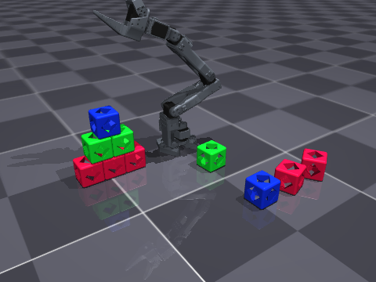

# Compte rendu — pyramide avec vision IA et calculs classiques

## Résultat obtenu

Le bras construit une pyramide de **trois cubes rouges, deux verts et un bleu**. Les cubes sont ceux du sujet : ils mesurent 5 cm et gardent leurs trous. Dix cubes sont présents au départ ; quatre restent en réserve. Le bac est retiré.

La version finale a réussi **5 constructions sur 5 dispositions testées en simulation**. Les cubes restent droits et stables après la fin du mouvement. Cela ne garantit pas 100 % de réussite dans toutes les situations ni sur un bras réel.

[Voir la vidéo complète](classic/results/pyramid_3.mp4) — environ 3 min 16 s, lecture accélérée environ quatre fois. Les six cubes ont été saisis et posés par le bras ; le socle n’a pas été préparé à la main dans cet essai.

## Comment fonctionne le programme

1. **Voir.** Un petit réseau PyTorch apprend depuis zéro à classer les pixels : fond, rouge, vert ou bleu. Il a été entraîné sur 36 images de simulation, puis vérifié sur 12 autres images.
2. **Localiser.** On compare le contour détecté à la forme connue du cube. Avec la calibration de la caméra, ce calcul donne une position sur la table.
3. **Calculer.** La FK donne la position de la pince à partir des angles. La IK cherche les angles qui permettent d’atteindre une position demandée. Ces calculs sont classiques : aucune IA ne choisit les mouvements.
4. **Déplacer.** Le programme prépare le trajet avant chaque prise : approche, fermeture, levage, transport, pose et dégagement. Il passe au-dessus des cubes déjà posés et se redresse avant d’approcher l’étage voisin.
5. **Contrôler.** L’angle de fermeture détecte une pince vide. La caméra vérifie les coins colorés après chaque dépôt, en évitant le trou central. Le banc de test mesure ensuite séparément les positions physiques finales.

**L’IA est donc limitée à la vision.** Les anciens essais d’apprentissage des mouvements sont abandonnés et conservés comme archives.

## Mesures de la version finale

Un essai est déclaré réussi lorsque les six cubes distincts sont à moins de 12 mm des positions prévues, sont droits, et bougent de moins de 2 mm pendant cinq secondes finales.

| Disposition | Construction complète | Plus grande erreur finale | Déplacement pendant les 5 s finales |
| --- | --- | --- | --- |
| 0 | Réussie | 4,02 mm | 0,011 mm |
| 1 | Réussie | 3,92 mm | 0,012 mm |
| 2 | Réussie | 9,86 mm | 0,037 mm |
| 3, filmée | Réussie | 3,95 mm | 0,007 mm |
| 4 | Réussie | 3,96 mm | 0,007 mm |

Les dispositions 0 et 3 ont servi aux réglages ; les dispositions 1, 2 et 4 ont servi à une vérification complémentaire. Les échecs des versions précédentes sont conservés : le tableau décrit uniquement la version finale.

La vision obtient un recouvrement des pixels colorés, appelé IoU, proche de 0,96 sur les 12 images de validation. Ce nombre ne mesure pas le taux de saisie. L’ajustement géométrique a réduit l’erreur de localisation à environ 1 mm sur la scène utilisée pour le comparer.

Le bilan numérique est dans [validation_summary.json](classic/results/validation_summary.json). Chaque essai conserve aussi ses étapes et ses positions finales.

## ROS et RViz

La solution comprend trois programmes : le driver gère le simulateur et les moteurs, la vision analyse les images, et le cerveau prépare les mouvements. Les commandes passent exclusivement par `/joint_command`.

Une séquence complète a aussi terminé dans ROS, avec RViz ouvert. Son image finale et une observation supplémentaire de cinq secondes de simulation sont conservées dans [ros_final.png](classic/results/ros_final.png) et [ros_observation.json](classic/results/ros_observation.json). Cette observation ROS est visuelle ; les mesures physiques chiffrées du tableau viennent du banc direct MuJoCo.

## Problèmes corrigés

Les premiers essais perdaient le cube pendant le transport. Une prise verticale légèrement plus haute, un serrage de 1,2 Nm et des mouvements lents ont amélioré le maintien. Une meilleure estimation de la position par l’image a ensuite rendu les prises plus régulières.

Un autre problème apparaissait au deuxième étage : le cube transporté heurtait son voisin. Le trajet a été relevé, puis décalé vers l’avant avant la pose. Enfin, le retrait du sommet a été adapté à la portée du bras.

Aucun cube n’est collé à la pince. Les propriétés physiques des cubes et leurs trous sont conservés. La collision de la mâchoire représente sa forme détaillée. Les positions réelles des objets servent aux mesures de test, jamais au choix des cibles ou des commandes.

## Limites

Les positions initiales sont tirées au hasard parmi douze emplacements, avec une petite variation. Les faces sont orientées dans le plan de prise : les orientations quelconques ne sont pas validées. Certains emplacements restent difficiles ou inaccessibles ; le programme peut choisir un autre cube visible de la bonne couleur.

Le banc direct autorise jusqu’à trois prises par destination. La version ROS s’arrête à la première perte de prise. La trajectoire est adaptée à cette scène ; ce n’est pas un programme général d’évitement de tous les obstacles.

Trois étages sont validés. Quatre étages ne sont pas validés. Aucun essai sur un bras réel n’a été effectué ; la caméra, les moteurs et les paramètres physiques devraient être calibrés avant ce passage.

## Ce que je montre pendant la présentation

Je montre d’abord la vidéo et la pyramide finale. J’explique ensuite que l’IA voit les couleurs, tandis que les calculs FK/IK déplacent le bras. Je présente les cinq essais et leurs limites, puis les trois fichiers principaux : `vision.py`, `kinematics.py` et `calibrated_planning.py`.

Le [guide des fichiers](classic/README.md) et les lanceurs Windows permettent de refaire la démonstration.
