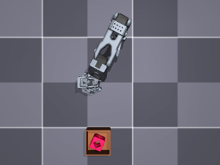

# Compte rendu - cube creux vers bac

Date : 7 novembre 2026.

## Resultat observe

Docker a ete demarre et les programmes ont ete construits puis executes. Un cycle complet avec detection par camera a reussi : approche, descente, fermeture, levage, transport, ouverture et retrait. L'image finale montre le cube rouge dans le bac et la pince retiree.



La position estimee du cube est passee de (0,139 ; 0,199 ; 0,025) m a (0,0457 ; -0,2557 ; 0,025) m. Le centre estime du bac est (0,0472 ; -0,2507) m. Ces valeurs viennent de la camera et de l'hypothese de hauteur ; elles ne mesurent pas une erreur absolue de calibration.

Il s'agit d'un cycle complet reussi observe, pas d'un taux de fiabilite sur des dizaines d'essais. Le message de fin de programme ne confirme pas a lui seul la prise : la validation a aussi utilise l'image finale.

## Le trou au milieu

Le modele original du cube creux est conserve. Ses huit pieces de collision laissent les tunnels ouverts. Aucun collage artificiel, aucune attache au robot et aucun remplacement par un cube plein n'ont ete ajoutes. La pince saisit le cube par les contacts physiques du modele.

Avant le cycle camera, un essai mecanique a utilise une position connue pour isoler la prise. Le centre du cube est monte a environ 9,2 cm pendant le levage puis est redescendu a 2,9 cm dans le bac, dont le fond est legerement suréleve. Position finale mesuree dans cet essai : (0,0514 ; -0,2516 ; 0,0290) m. La verite MuJoCo n'est utilisee que dans ce diagnostic, jamais pour piloter la chaine ROS.

## Travail realise

Les cinq PDF du dossier docs ont ete lus par extraction de texte. La solution conserve les trois programmes demandes : driver (moteurs et camera), perception (couleurs et projection en 3D), cerveau (angles et succession des etapes). Les commandes de moteur passent par `/joint_command`.

Le code et les explications utilisent des fonctions courtes et des commentaires en francais. Le guide debutant donne les commandes pour demarrer, lancer un cycle, observer et arreter.

## Corrections trouvees pendant les essais

- Fins de ligne Windows du script de lancement : conversion au format Linux et ajout de `.gitattributes`.
- Perception ignoree par la construction : retrait de `COLCON_IGNORE`.
- Nom `publishers` reserve par ROS : remplacement par `position_pubs`.
- Attente de la fin de construction avant le demarrage de la perception.
- Hauteur de transport de 14 cm inaccessible avec pince verticale : passage a 8 cm, teste.
- Confusion entre bac marron et rouge : seuil rouge resserre.
- Camera placee au-dessus de la table pour mieux voir le cube et le bac.
- Graine de simulation fixee a 1 par defaut pour pouvoir reproduire la demonstration ; parametre `seed` du driver.

## Verifications

- Construction Docker et construction des six paquets ROS : reussies.
- Deux tests numeriques : reussis (cibles de prise/depot et refus d'une cible trop eloignee).
- Essai physique isole du cube creux : depot reussi.
- Premier essai camera : echec, mauvaise detection du bac comme cube ; correction effectuee.
- Essai camera apres correction : cycle complet reussi, image finale conservee.

Scripts de verification : `ros2_ws/checks/grasp_test.py`, `live_test.py` et `test_kinematics.py`. Le premier est un diagnostic qui accede directement au simulateur ; le second utilise les messages et le service ROS. Les images de chaque etape sont dans le meme dossier.

## Limites restantes

La calibration camera vient encore du simulateur. La calibration personnelle demandee par le sujet reste a faire. La prise n'est pas automatiquement confirmee, les obstacles ne sont pas planifies et un cube deplace pendant le cycle n'est pas suivi. Plusieurs positions et orientations du cube creux doivent encore etre testees pour annoncer une solution robuste. Aucun essai sur bras reel n'a ete effectue. La phase 2 exploratoire reste hors de cette demonstration.

Les conteneurs control et perception sont laisses demarres. Le cycle est termine ; le bras ne recommence pas automatiquement. Pour repartir avec le cube sur la table, redemarrer control, attendre la fin de construction puis appeler `/brain/start`.

## Video et RViz

Un nouveau cycle complet avec camera a reussi pendant l'enregistrement. La video MP4 dure 44,6 secondes, contient les images de la simulation et le nom des etapes. Fichier : [Video du cycle](../ros2_ws/checks/cube_vers_bac.mp4). L'image finale confirme le cube dans le bac.

RViz a ete ouvert sur Windows via WSLg et verifie visuellement : modele du bras et image camera visibles. Pour le relancer depuis le dossier docker :

```sh
docker compose up -d viz
docker compose -f docker-compose.yml -f docker-compose.windows.yml up -d rviz
```

Ce fichier supplementaire utilise l'affichage WSLg de Docker Desktop ; il est propre a cet environnement Windows.
